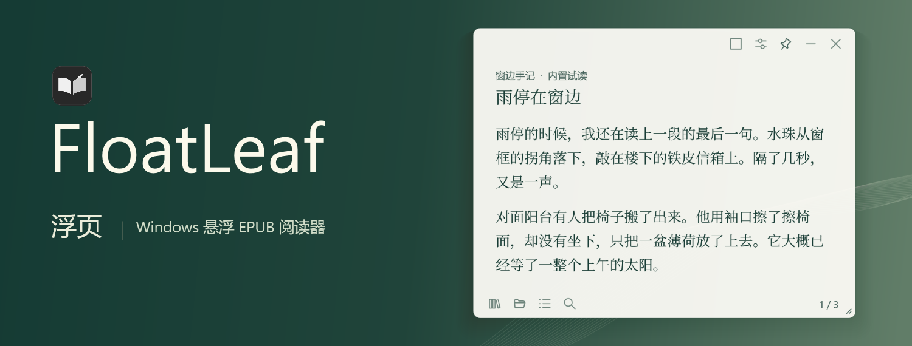

<h1 align="center">FloatLeaf · 浮页</h1>

<p align="center">一个可以放在桌面一角的 Windows EPUB 阅读器。</p>

<p align="center">
  <strong><a href="https://github.com/LeFeuFollet/FloatLeaf/releases/latest/download/FloatLeaf-Windows.zip">下载 Windows 便携版 ↓</a></strong>
  &nbsp;·&nbsp; <a href="https://github.com/LeFeuFollet/FloatLeaf/releases">版本记录</a>
  &nbsp;·&nbsp; <a href="#从源码构建">从源码构建</a>
  &nbsp;·&nbsp; <a href="https://github.com/LeFeuFollet/FloatLeaf/issues">反馈问题</a>
</p>



把书拖到浏览器或编辑器旁边，把窗口缩到刚好放下几行字。背景和文字的透明度可以分别调整。只想留几行正文时，关闭「移出隐藏」，把背景调到全透明，再把鼠标移开即可。

## 开始阅读

1. 在 Windows 10 或 11 上，将便携版 ZIP 解压到有写入权限的文件夹，双击 `FloatLeaf.exe`。运行需要 .NET Framework 4.8。
2. 点击 **内置试读** 翻开《窗边手记》，或直接把自己的 `.epub` 拖进窗口。浮页会把导入的书复制到程序旁的 `Books/`。
3. 按 `Ctrl+Home` 回到书架。下次点击书名，会从上次读到的位置继续。

## 阅读体验

| 想做什么 | 在浮页里怎么做 |
| --- | --- |
| 把书留在手边 | 拖动顶栏移动窗口，拖动右下角调整大小。点击图钉可置顶。开启「移出隐藏」后，鼠标离开时窗口隐去，移回原处便会再出现。 |
| 调出舒服的版式 | 分别设置中英文字体、文字颜色和背景颜色。可输入 HEX 色值，也可用吸管从屏幕取色。界面支持中文和英文。 |
| 像读纸书一样翻页 | 可选「上下滑动」或「左右翻页」。滑到章末继续滚动即可换章，分页时点正文两侧即可翻页。 |
| 找回前文的一句话 | 按 `Ctrl+F` 选「向前搜索」，可以连续查看几处匹配。看完按 `Alt+←`，直接回到搜索前的段落。 |
| 找人名时避开剧透 | 「向后搜索」默认遮住后文章节名和摘录，再点一次同一条结果才会跳转。想直接浏览摘录，可开启「默认显示后文」。 |
| 随手读脚注 | 点击带链接的注释标记，注释就在正文旁展开。长注释可以滚动，点弹窗外即可收起。 |

浮页随附八款正文字体，包括霞鹜文楷 GB Lite、朱雀仿宋和 Source Serif 4。中英文可以分别搭配，也可以导入自己的 TTF、OTF 或 TTC 字体。[查看字体与许可证](assets/fonts/README.md)

## 常用快捷键

| 快捷键 | 操作 | 快捷键 | 操作 |
| --- | --- | --- | --- |
| `Ctrl+O` | 导入 EPUB | `Ctrl+Home` | 返回书架 |
| `Ctrl+F` | 搜索全书 | `Alt+←` | 从搜索结果返回原段 |
| `Ctrl+D` | 打开目录 | `Ctrl+,` | 打开设置 |
| `Ctrl+T` | 切换置顶 | `Ctrl+Alt+R` | 全局显示或隐藏窗口 |

全局快捷键被其他程序占用时，浮页会尝试备用组合。实际启用的快捷键显示在设置底部。

## 书架与格式

- **适合的书**　以文字为主的 EPUB 2 和 EPUB 3。浮页会提取章节、目录和链接注释，略过图片、复杂排版及嵌入媒体。纯图片书和加密正文暂不支持。
- **书架备份**　复制程序旁的 `Books/` 即可备份书籍。重复导入相同内容只会收录一次，同名但内容不同的书会分别保留。
- **进度与偏好**　保存在 `%LOCALAPPDATA%\FloatLeaf\settings.xml`。进度按书籍的完整路径匹配，迁移到另一台电脑时，保留相同的书架路径并复制设置文件，即可接续阅读。

## 从源码构建

在装有 .NET Framework 4.8 的 Windows 上，于仓库根目录运行：

```powershell
powershell -NoProfile -ExecutionPolicy Bypass -File .\build.ps1 -Package
```

脚本使用 .NET Framework 自带的 C# 编译器。构建会生成根目录下的 `FloatLeaf.exe`，并将程序和许可证打包为 `dist/FloatLeaf-Windows.zip`。只需编译时可以省略 `-Package`。

## 许可证

程序源码采用 [MIT 许可证](LICENSE)。内置字体按各自的 [SIL Open Font License](assets/fonts/README.md) 分发。
